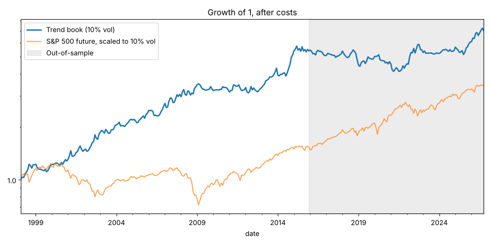
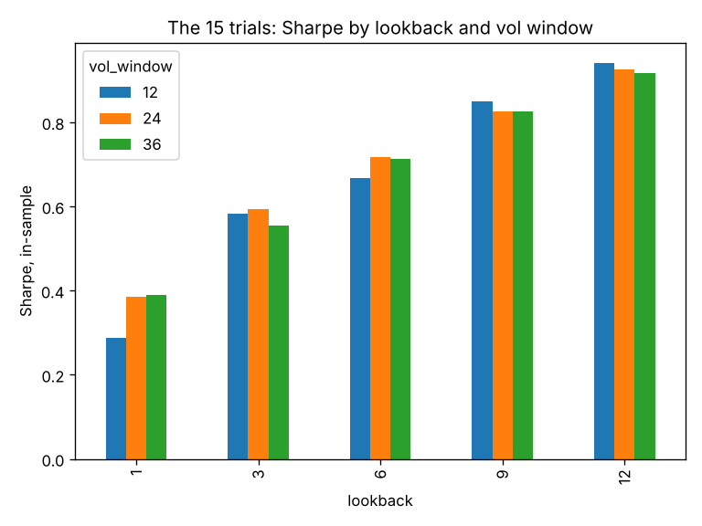
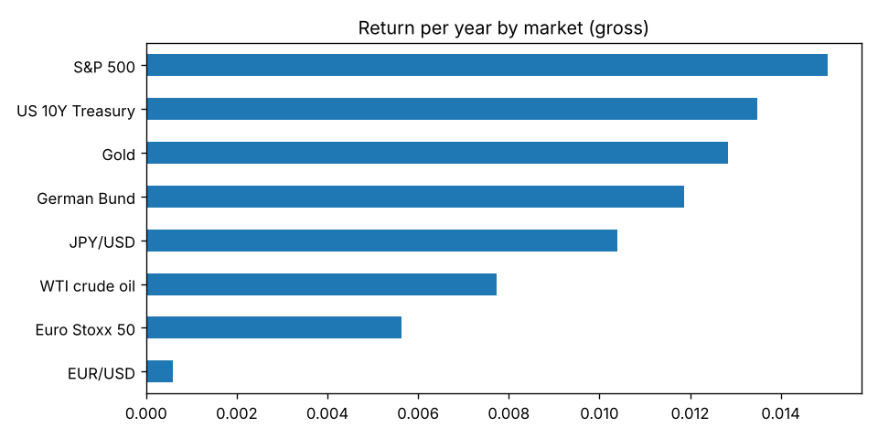
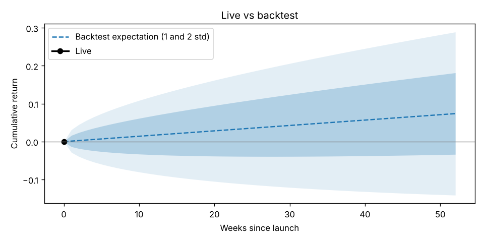

# Trend Following on Futures: Backtest and Live Track Record

I test the oldest systematic strategy in hedge funds: **buy what has gone up over the last
year, sell what has gone down**. This is what CTAs like Man AHL, Winton or AQR Managed
Futures do. I trade 8 futures across equities, bonds, currencies and commodities, with
monthly Bloomberg data from 1996 to October 2026.

Two questions drive the project:
1. **Is the Sharpe real, or did I find it by luck?** I answer with the t-stat, the Deflated Sharpe Ratio and a frozen out-of-sample period.
2. **Does it survive in real time?** From 30 November 2026, I run the book live on paper and publish my positions every weekend, before the market opens ([LIVE.md](LIVE.md)).

| Result (after costs) | 1998-2015 (in-sample) | 2016-2026 (out-of-sample) |
|---|---|---|
| Return per year | 10.0% | 3.0% |
| Volatility | 10.8% | 10.6% |
| **Sharpe** | **0.93** | **0.29** |
| t-stat | 3.9 | 0.9 |
| Max drawdown | -11% | -25% |

## 1. The strategy

Each month-end, for each future:
- **Signal**: long if its return over the last 12 months is positive, short if negative (Moskowitz, Ooi and Pedersen, 2012).
- **Size**: 10% volatility per market, so a quiet Bund gets a bigger position than a wild oil contract. Every market brings the same risk.
- **Book**: the sum of the 8 positions, scaled to 10% volatility. Volatility uses the last 24 months only.
- **Timing**: the signal at the end of month t is traded in month t+1. No look-ahead.

**Why should it work?** Prices react slowly to news and then overshoot (herding). Hedgers,
such as airlines, miners and central banks, pay a premium to offload risk. Trends also
appear in crises because they unfold over months: rates fell for all of 2008, and rose for
all of 2022.

## 2. Data and the roll

| Asset class | Futures (Bloomberg generic 1st and 2nd contract) |
|---|---|
| Equity | S&P 500 (ES), Euro Stoxx 50 (VG) |
| Bonds | US 10Y Treasury (TY), German Bund (RX) |
| Currencies | EUR/USD (EC), JPY/USD (JY) |
| Commodities | WTI crude oil (CL), Gold (GC) |

A future expires, so I cannot use the 1st contract price as is: on the roll date the price
jumps from one contract to the next. I build the return of a trader who always holds the
front contract:
- normal month: `X1(t) / X1(t-1) - 1`
- roll month: `X1(t) / X2(t-1) - 1`, because the contract I hold now was the 2nd contract last month.

This also removes two fake jumps in the raw data: the Bund converted from DEM to EUR in
1998, and the US 10Y futures coupon cut from 8% to 6% at the end of 1999.

Costs: 1 to 3 bp per trade depending on the market, paid when positions change and twice at each roll.

The Bloomberg data comes from photos of the HP screen. Each series is checked against the
screen's average, high and low. **Raw Bloomberg data is not published** (licence).

## 3. Backtest



- **1998-2015**: the textbook CTA. 10% per year at 10% volatility. Losing years are rare and small (worst: -3% in 2009).
- **2016-2021**: the "CTA winter". -17% over six years. Rates were pinned at zero, markets went sideways, and trends kept reversing. Real CTAs had the same problem.
- **2022-2026**: the trends come back (inflation, rate hikes, oil). +58%, Sharpe 0.9.

The out-of-sample Sharpe (0.29) is far below the in-sample one (0.93). This is the most
honest number in the project: it is what happens when you run a strategy after you
discovered it.

## 4. Is the Sharpe real?

Three measures, three different questions:

| Measure | Question | Formula | My result |
|---|---|---|---|
| Sharpe | How much return per unit of risk? | mean / std × √12 | 0.93 (in-sample) |
| t-stat | Could the mean be zero, and I was lucky? | Sharpe × √years | 3.9 |
| Deflated Sharpe | Same, knowing I tried 15 versions | see below | 0.99 |

**t-stat.** Above 2, the result is unlikely to be pure chance. Harvey, Liu and Zhu (2016)
ask for 3, because finance tests thousands of ideas. The in-sample result passes (3.9).
The out-of-sample result does not (0.9). Ten years at Sharpe 0.3 cannot be told apart from zero.

**Deflated Sharpe Ratio (Bailey and Lopez de Prado, 2014).** If I try 15 versions, the
best one looks good even if none works. The DSR first computes the Sharpe the best of 15
useless strategies would show by luck: **0.37**. It then corrects for the length of the
data and for fat tails. The result is the probability that the true Sharpe is above zero:
**0.99**. Every version I tried is written in [`results/trials_log.csv`](results/trials_log.csv),
so the number of trials is honest.



The 15 trials (lookbacks of 1, 3, 6, 9 and 12 months; volatility windows of 12, 24 and 36
months) tell a clear story. The longer the lookback, the better: 1 month is close to noise
(Sharpe 0.3), and 12 months is the best (0.93). The volatility window barely matters. I did
not pick 12 months after seeing this: it is the rule of the original paper, fixed before I
ran anything.

**What I conclude.** The edge is real but smaller than the in-sample number. A fair
expectation for the future is a **Sharpe between 0.3 and 0.7**.

## 5. Is it a new alpha?

I regress the monthly P&L on the S&P 500 future: alpha **+8.1% per year (t = 4.0)**, beta
**-0.09**, R² 2%. The book is not long stocks in disguise. It is slightly short equity risk,
which is what an investor wants next to a stock portfolio.

The real test is against other CTAs: if my book is just the AQR time-series momentum
factor, it is a known premium, not a new alpha. The code runs this comparison as soon as
the AQR file is added (`data/aqr_tsmom.csv`).

## 6. Where the money comes from: crisis alpha



Every market makes money over 1998-2026. The biggest contributors are the S&P 500, the
US 10Y, gold and the Bund. EUR/USD barely contributes.

**Crisis alpha.** The book makes money when stocks crash:

| Period | Trend book | S&P 500 future |
|---|---|---|
| Dot-com bear (Sep 2000 - Sep 2002) | **+43.7%** | -49.5% |
| Financial crisis 2008 | **+10.4%** | -39.2% |
| Oil crash (Jul 2014 - Jan 2015) | **+33.6%** | +2.6% |
| Covid (Feb - Mar 2020) | +0.7% | -20.1% |
| Inflation 2022 | **+22.8%** | -19.8% |

Covid is the exception. The crash took four weeks, faster than a 12-month signal can turn.

## 7. Live track record

The rules are frozen in [RULES.md](RULES.md) and published before the first trade. Every
Friday I take the Bloomberg prices. Over the weekend I compute the P&L of the week. Before
Monday 9:00 Paris time I commit. The commit time stamp proves the positions were chosen
before the market moved. Positions change once a month; at each rebalance I add a short
letter to investors.

| Since launch (30 Nov 2026) | |
|---|---|
| Weeks | 0 |
| Cumulative P&L | - |
| NAV (start 1,000,000 USD) | - |
| Worst week | - |

**First positions** (traded on Monday 30 November 2026): computed from the prices of Friday
27 November. The signal at the end of October points to long S&P 500, Euro Stoxx 50 and
oil; short US 10Y, Bund, EUR/USD, JPY/USD and gold.

<!-- chart added after the first live week:  -->

After a few weeks a t-stat means nothing.
The real question is whether the live P&L stays inside the range the backtest expects.

**Latest week and full history:** [LIVE.md](LIVE.md).

## How to run

```
pip install -r requirements.txt
python backtest.py              # backtest, statistics and charts in results/
python live.py positions        # last weekend of the month: next positions
python live.py week             # every weekend: P&L of the week
```

References: Moskowitz, Ooi and Pedersen (2012), *Time Series Momentum*. Bailey and Lopez de
Prado (2014), *The Deflated Sharpe Ratio*. Harvey, Liu and Zhu (2016), *...and the
Cross-Section of Expected Returns*. Hurst, Ooi and Pedersen (2017), *A Century of Evidence
on Trend-Following Investing*.
